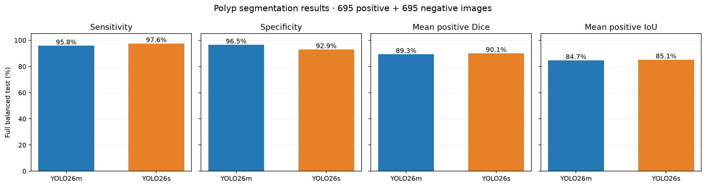
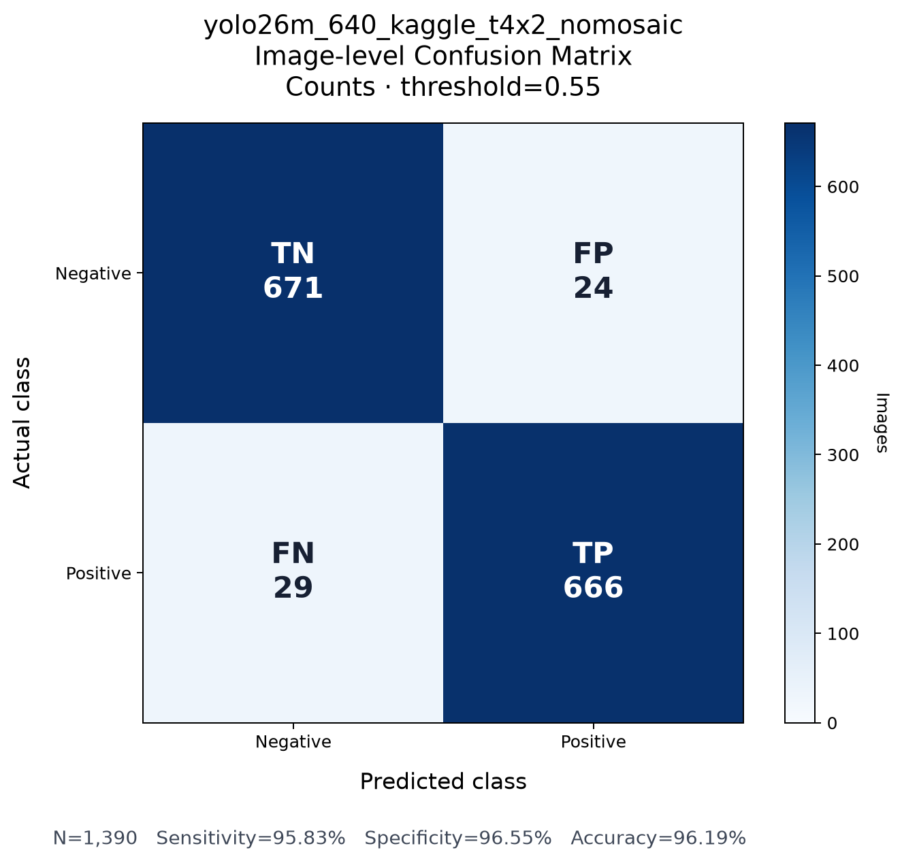
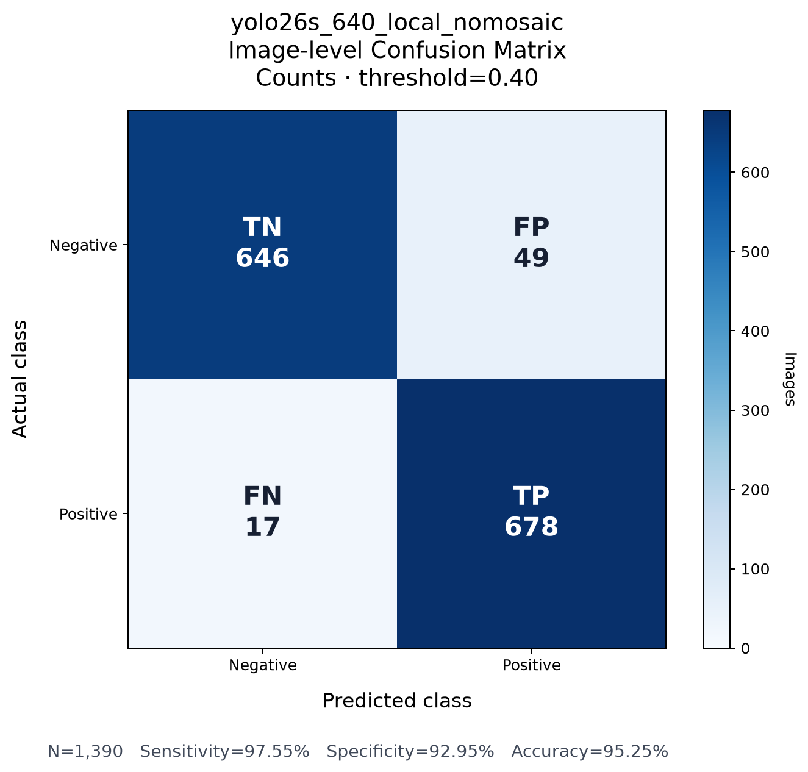

# Multi-Source Polyp Segmentation — Model Results

This repository reports saved evaluation results for **YOLO26m-seg** and **YOLO26s-seg** on the same 1,390-image balanced polyp segmentation test set. It contains per-image metrics, confusion matrices, training plots, qualitative errors, and code to recalculate the comparison. Model checkpoints will be linked separately when published.

**Open the [executed results notebook](model_results.ipynb)** to view the tables and figures directly on GitHub.

**Prepared by:** Teerawat Saenum

**Dataset:** [Multi-Source Polyp Segmentation Dataset](https://github.com/YABYABuwu/Multi-Source-Polyp-Segmentation-Dataset) · 695 polyp images + 695 normal images in the test split.

## Full balanced-test results

Sensitivity and specificity use image-level polyp presence. Dice and IoU are means over the **695 positive images only**; empty negative masks are excluded from those means. All values below are recalculated from the included per-image CSVs.

| Run | TP | FN | TN | FP | Sensitivity | Specificity | Mean positive Dice | Mean positive IoU |
|---|---:|---:|---:|---:|---:|---:|---:|---:|
| [YOLO26m](runs/yolo26m/) | 666 | 29 | 671 | 24 | 95.8% | 96.5% | 0.893 | 0.847 |
| [YOLO26s](runs/yolo26s/) | 678 | 17 | 646 | 49 | 97.6% | 92.9% | 0.901 | 0.851 |



YOLO26s identified 12 more positive images, while YOLO26m had 25 fewer false positives. Their mean positive Dice differs by 0.008 on this test. The runs used different hardware and batch sizes, so this is a comparison of these **saved runs**, not an isolated architecture experiment.

## Primary WLI subset

The separately saved WLI/standard subset has 874 images: 437 positive and 437 negative. These rows are part of the full test above, not an additional independent test set.

| Run | TP | FN | TN | FP | Sensitivity | Specificity | Mean positive Dice | Mean positive IoU |
|---|---:|---:|---:|---:|---:|---:|---:|---:|
| YOLO26m | 420 | 17 | 413 | 24 | 96.1% | 94.5% | 0.897 | 0.850 |
| YOLO26s | 425 | 12 | 398 | 39 | 97.3% | 91.1% | 0.899 | 0.849 |

## Evaluation and training settings

Both models were evaluated on the **same image IDs and ground-truth labels**, verified by [`scripts/build_summary.py`](scripts/build_summary.py). Confidence thresholds were selected using validation data: **0.55 for YOLO26m** and **0.40 for YOLO26s**. The included [`validation_threshold_sweep.csv`](runs/yolo26m/validation_threshold_sweep.csv) files record those checks for each model.

| Setting | YOLO26m | YOLO26s |
|---|---|---|
| Input size | 640 px | 640 px |
| Mosaic augmentation | 0.0 | 0.0 |
| Optimizer / initial learning rate | AdamW / 0.001 | AdamW / 0.001 |
| Seed / planned epochs | 42 / 100 | 42 / 100 |
| Training environment | Kaggle, 2× T4 | Local GPU |
| Batch size | 16 | 4 |
| Early-stop patience | 20 | 25 |

See each run's `train_args.json` for saved training arguments. Different hardware and batch settings limit direct attribution of the result gap to model size.

## What is in this repository

```text
README.md
model_results.ipynb                executable report with saved tables and figures
results_summary.json                 metrics recalculated from per-image CSVs
figures/model_comparison.png        four-metric comparison chart
scripts/build_summary.py            checks matched test IDs; rebuilds summary and chart
runs/yolo26m/
runs/yolo26s/
  full_test_per_image_metrics.csv    1,390 test-image predictions and pixel metrics
  primary_wli_balanced_test.csv      874-image WLI subset
  image_level_confusion_matrix.csv   TP, FN, TN, FP source table
  test_metrics_by_source_category.csv
  validation_threshold_sweep.csv
  results.csv / results.png          training curves
  image_level_confusion_matrix.png
  qualitative_error_cases.png
  train_args.json
```

### Visual review

| YOLO26m | YOLO26s |
|---|---|
|  |  |
| [Qualitative error cases](runs/yolo26m/qualitative_error_cases.png) | [Qualitative error cases](runs/yolo26s/qualitative_error_cases.png) |

## Recalculate results

```bash
python -m pip install -r requirements.txt
python scripts/build_summary.py
jupyter notebook model_results.ipynb
```

The script verifies that both models' CSV files contain the same image IDs and labels, then writes `results_summary.json` and `figures/model_comparison.png`.

## Model files and limits

| Model checkpoint | Download |
|---|---|
| YOLO26m-seg | **Link will be added later** |
| YOLO26s-seg | **Link will be added later** |

No weights or full image dataset are stored here. The dataset repository provides provenance and original source links. These results are retrospective test-set measurements; there is no patient-independent external clinical validation established by the available artifacts, and video predictions without ground truth are not accuracy measurements.
